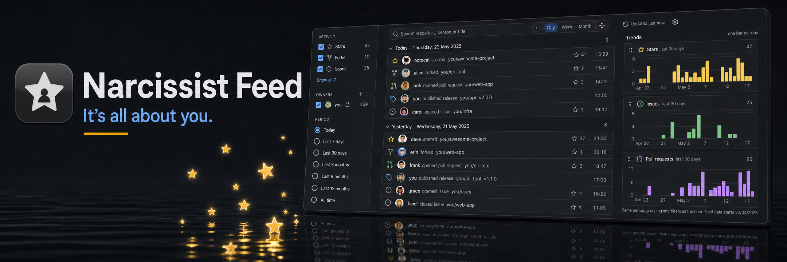
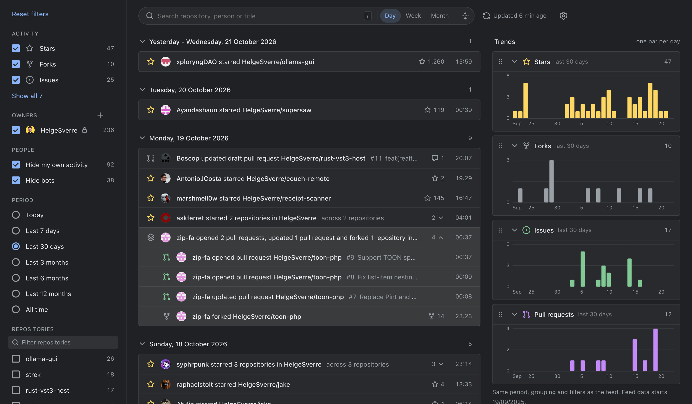

# Narcissist Feed for GitHub

[](https://github.com/HelgeSverre/github-narcissist-feed/actions/workflows/ci.yml)
[](LICENSE)


A Chrome extension that shows what happens _to_ your repositories: who starred or forked them, and the issues, pull requests, comments, reviews and releases in them. It's chronological and filterable, with no logo or navbar. It looks like a `chrome://` page.

It covers your own repositories plus any users or organizations you add (for example `sema-lisp`).

- [Features](#features)
- [Install](#install)
- [Token](#token)
- [Using it](#using-it)
- [How it works](#how-it-works)
- [Privacy and permissions](#privacy-and-permissions)
- [Development](#development)
- [License](#license)

## Features

- **Everything that happens to your repositories in one feed**: stars, forks, issues, pull requests, comments, reviews and releases, grouped by day, week or month.
- **Dormant repositories count too.** An hourly full sweep covers every repository, so a star on a project you haven't touched in years still shows up.
- **Stacking** folds repeated actions by the same person into one row.
- **Trends** shows charts of stars, forks, issues and pull requests next to the feed.
- **Unstars and deleted forks** (optional): GitHub doesn't report these, so the extension tracks them itself.
- **Chrome WebUI look** in light and dark, at default or compact density, with a choice of accent colours (Chrome's tab group colours or any hex).
- **Keyboard friendly**: visible focus rings everywhere, and arrow-key navigation in the filter rail.
- **Runs entirely in your browser**: no server, no runtime dependencies, and it only talks to `api.github.com`.



_Dark mode, last 30 days, with your own activity and bots hidden. One person's pull requests and fork on a single repository are folded into a stack, shown expanded here._

## Install

The extension is not on the Chrome Web Store yet. Build it and load it unpacked:

```sh
bun install
bun run build          # writes dist/
```

1. Open `chrome://extensions`.
2. Turn on **Developer mode** (top right).
3. Click **Load unpacked** and pick the `dist/` folder.
4. Click the extension icon in the toolbar (pin it for one-click access). The first time, the page opens on Settings; paste a token (see [Token](#token)). Clicking the icon again focuses the open tab instead of opening another.

After running `bun run build` again, click the reload icon on the extension card. Chrome 137+ ignores `--load-extension`, so loading from the Extensions page is the only option.

## Token

GitHub's GraphQL API has no anonymous mode, so you need a personal access token.

1. Create a **fine-grained** token at <https://github.com/settings/personal-access-tokens/new>.
2. Repository access: **All repositories**, so new repositories are included. Pick _Public repositories_ if you don't want private ones.
3. Repository permissions: **Metadata**, **Issues** and **Pull requests** read-only, and **Contents**.
4. Contents level: fine-grained tokens can only list stargazers with **Contents: Read and write**. GitHub's API reports `contents=write` for `GET /repos/{owner}/{repo}/stargazers`. With Contents read-only, everything except stars loads and the feed shows a warning. The extension never writes anything.
5. Paste it into **Settings → GitHub**. The extension validates the token, fills in your username and starts a full refresh.

## Using it

- **Rail**: activity types, owners, hiding your own activity, hiding bots, period and repositories. The `+` next to owners searches your organizations, the people you follow and all of GitHub. Click a section heading to collapse it. Counts are for the selected period.
- **Rail from the keyboard**: ↑/↓ move between filters, Home/End jump to the first and last, Space toggles. On a section heading, ← collapses and → expands; ← anywhere in a section goes back to its heading. In Activity, Shift+↑/↓ selects several types and Space toggles them together.
- **Toolbar**: search (`/` focuses it), group by day, week or month, collapse all groups, refresh, settings.
- **Rows**: the username links to the profile and the repository name to the repository. The rest of the row opens the item.
- **Stacking** (Settings → Stacking): folds repeated actions by the same person. _Repository_ scope folds within one repository. _Organization_ also folds across repositories of one owner. _Activity type_ folds everything of one type inside a group. Each scope has its own time window. Click a stack to expand it.
- **Trends**: charts that use the same period, grouping and filters as the feed. Drag a chart to reorder it, or click its name to collapse it. Turn the column on or off in Settings → Feed.
- **Date and time**: date format, 12- or 24-hour time, first day of the week.
- **Appearance**: theme (System, Light or Dark), density, and accent colour. The accent drives checkboxes, links, focus rings and selected items. Pick a preset or enter any hex code; the extension derives a light-theme and a dark-theme shade in OKLCH that keep the hue and stay readable (at least 4.5:1 contrast on every surface).

## How it works

- **Batched GraphQL.** A cheap listing query collects repository IDs for every owner in parallel, 100 per request. Details are then fetched 20 repositories per request, with 6 requests in flight. Each repository returns its last 5 stargazers, 5 forks, 5 issues, 5 pull requests (each with its last 2 comments and 2 reviews) and 3 releases. A full sweep of about 540 repositories takes about 25 seconds and uses about 110 of the 5,000 rate-limit points per hour (4 points per request).
- **Quick refresh** (every 5, 10 or 30 minutes; configurable): the 40 most recently pushed repositories per owner.
- **Full sweep** (hourly, and after you change owners or the token): every repository. The feed exists to catch stars on dormant repositories, so the full sweep is never skipped.
- **Background fetching.** The service worker fetches on `chrome.alarms`. The page renders instantly from storage and updates live.
- **Unstars and deleted forks.** GitHub doesn't report these. The extension keeps a ledger per repository with its star count and last stargazers. When the count drops and a login disappears from that window, it records an _unstarred_ row. This is off by default (Settings → Feed).
- **Bursts.** If a repository gains more than 5 stars or forks between refreshes, a follow-up query pages further back so none are missed.
- **Bots** are detected from GitHub's account type (`Bot`), not from their names.
- **Private access.** A lock icon next to an owner means your token can read private repositories there: your own, or those of an organization you belong to.

## Privacy and permissions

The token is stored in `chrome.storage.local` in your browser profile. It is never synced and is only ever sent to `https://api.github.com`. All other settings live in `chrome.storage.sync`. There is no server, analytics or telemetry.

| Permission                 | Why                                    |
| -------------------------- | -------------------------------------- |
| `storage`                  | settings, token, cached events         |
| `alarms`                   | periodic refresh in the service worker |
| `https://api.github.com/*` | the only host the extension talks to   |

## Development

Run `just` to list the task recipes (`dev`, `build`, `clean`, `icons`, `test`, `e2e`, `e2e-headed`, `lint`, `format`). They run `bun install` automatically when `bun.lock` has changed, and call the package scripts below. `just e2e-headed` shows the browser and slows each action (`E2E_SLOWMO`, default 50 ms); `HEADED=1` does the same for any e2e run.

Requires [Bun](https://bun.sh) 1.4+ as the package manager, and Node 22+ for Vite, Vitest and svelte-check.

| Command            | What it does                                                                                           |
| ------------------ | ------------------------------------------------------------------------------------------------------ |
| `bun run dev`      | Vite and CRXJS with hot reload. Load `dist/` once; after that, edits reload the extension.             |
| `bun run build`    | Production build into `dist/`.                                                                         |
| `bun run lint`     | oxlint (correctness and suspicious rules, warnings fail).                                              |
| `bun run check`    | Type-checks the app (`svelte-check`) and the tests, scripts and configs (`tsc -p tsconfig.node.json`). |
| `bun run format`   | Formats everything with oxfmt. `bun run format:check` only reports.                                    |
| `bun run test`     | Unit tests (Vitest). Fast, offline, no browser.                                                        |
| `bun run test:e2e` | Builds, then runs the end-to-end suite in Chrome for Testing.                                          |
| `bun run icons`    | Re-renders the PNG icons and `public/favicon.svg` from `assets/icon/icon.svg`.                         |

CI runs `lint`, `check`, `format:check`, `test` and `build` on every push and pull request, and uploads `dist/` as an artifact.

### Tests

- **Unit tests** sit next to the code they test, as `src/**/*.test.ts`. They run in Node with an in-memory `chrome.storage` mock (`tests/helpers/chrome-mock.ts`). `vitest.config.ts` pins the timezone and locale, so date tests give the same result on every machine.
- **End-to-end tests** live in `tests/e2e/*.e2e.test.ts` and drive the built extension in a real browser through `puppeteer-core`. Branded Google Chrome ignores `--load-extension`, so on the first run the suite downloads a pinned Chrome for Testing build into `.cache/chrome` (about 365 MB). Each test file gets a fresh, temporary browser profile.
- **Tokens for e2e**: the suite uses `GITHUB_TOKEN`, or the token from `gh auth token`. Without either, the files that need a token are skipped. The fine-grained scenario only runs when `GITHUB_FINE_GRAINED_TOKEN` is set to a token without stargazer access.
- **Failures**: screenshots of failing e2e tests go to `.cache/e2e-failures/`.

### Layout

```
src/
  background/index.ts    service worker entry: lifecycle, alarms and message wiring only
  background/account.ts  token validation, owner search and resolve, people list
  background/refresh.ts  refresh sweep: queue, parallel GraphQL fetch, incremental save
  background/ledger.ts   pure event merge, unstar/unfork diff, pruning
  background/log.ts      shared log prefix
  lib/github.ts          GraphQL client, queries, normalisation to FeedEvent
  lib/feed.ts            filtering, stacking, grouping, chart buckets (pure)
  lib/format.ts          date/time formatting, group labels, week numbers
  lib/prefs.ts           synced settings, filters and layout (see docs/specs/persistence-and-sync.md)
  lib/storage.ts         chrome.storage layout and device-local data
  lib/app.svelte.ts      reactive app state (Svelte 5 runes), theme and accent applied to <html>
  lib/accent.ts          accent presets and OKLCH/contrast derivation of per-theme accent colours
  lib/radiogroup.ts      keyboard behaviour for segmented controls and swatches
  lib/railnav.ts         arrow-key navigation in the filter rail
  components/            Rail, Toolbar, Feed, Row, StackRow, Trends, Settings, …
  app.css                Chrome WebUI-flavoured tokens, light and dark
tests/
  helpers/               chrome.storage mock, fixture factories, unit-test setup
  e2e/                   end-to-end suite, global setup, browser helpers
public/boot.js           applies the cached theme and accent before first paint
scripts/render-icons.ts  icon renderer
assets/icon/             icon source (SVG) and store-size PNG
docs/specs/              design specs
docs/media/              README artwork
```

Built with Svelte 5, Vite 8, CRXJS 3, Manifest V3, TypeScript and Vitest. There are no runtime dependencies.

## License

MIT © [Helge Sverre](https://helgesver.re). See [LICENSE](LICENSE).

UI icons are [Octicons](https://primer.style/octicons) (MIT). The header image is AI-generated artwork.
